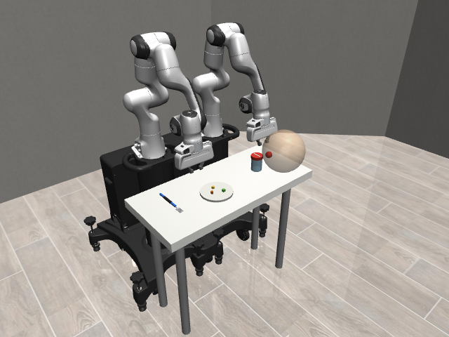

# KINA Assistive Manipulation Simulation

KINA is a MuJoCo simulation built on [robosuite](https://robosuite.ai/) for exploring
robot-assisted feeding and jar opening. Its custom `BimanualAssist` environment has two
Panda arms, a table, a fork, a plate with three food pieces, a lidded jar, and a visual
user head/mouth marker.



> **Important:** `main.py` is a separate, small robosuite `Lift` example. To launch the
> scene with the food and plate, use `scripts/view.py` or `scripts/teleop.py`.

## Quick start

### Linux

Python 3.10 or newer is recommended. The checked-in Conda environment uses Python 3.10;
the pip requirements have also been installed and the viewer launched successfully with
Python 3.12.

```bash
git clone https://github.com/nickcode1/KINA.git
cd KINA

python3 -m venv .venv
source .venv/bin/activate
python -m pip install --upgrade pip
python -m pip install -r requirements.txt

# Open the scene without controlling the arms
python scripts/view.py
```

If `python3 -m venv .venv` reports that `ensurepip` or `venv` is missing on Ubuntu/Debian,
install the matching venv package (for example, `sudo apt install python3.12-venv`) and
retry. The viewer requires a graphical desktop/display and MuJoCo-compatible OpenGL. In
remote or headless environments, use the headless checks below; offscreen rendering also
requires a working OpenGL context.

### Windows

Install Python, then in PowerShell from the repository directory:

```powershell
py -3.10 -m venv .venv
.\.venv\Scripts\Activate.ps1
python -m pip install --upgrade pip
python -m pip install -r requirements.txt
python scripts\view.py
```

If PowerShell blocks activation, use `.\.venv\Scripts\python.exe` in place of `python`.
The optional convenience scripts `teleop.bat` and `run_demo.bat` use the `.venv` when it
exists. They are Windows batch files and are not Linux launchers.

### Conda alternative

If Conda is installed, create and activate the environment described by `environment.yml`:

```bash
conda env create -f environment.yml
conda activate robo
python scripts/view.py
```

Conda is optional; a normal Python virtual environment works as shown above.

## Running the simulation

### View the scene

```bash
python scripts/view.py
python scripts/view.py --still   # show the scene without advancing the simulation
```

The viewer starts with both arms holding their pose. You can drag objects with the mouse:
double-click a body, then Ctrl + right-drag to apply a force.

### Drive the arms with the keyboard

```bash
python scripts/teleop.py
```

Click the MuJoCo viewer to focus it before using the keyboard. Robot 0 is the right arm;
robot 1 is the left. Movement directions use world coordinates.

| Key | Action |
|---|---|
| Up / Down | Move in +x / -x (toward the mouth / back) |
| Left / Right | Move in +y / -y |
| E / Q | Move up / down (+z / -z) |
| Z / X | Roll + / - |
| C / V | Pitch + / - |
| A / D | Yaw + / - |
| Shift (hold) | Slow movement for finer control |
| F | Toggle the active arm's gripper |
| N | Switch active arm |
| 1 / 2 | Select right / left arm |
| Esc or close viewer | Quit |

By default, the keyboard listener uses `pynput`; if it is unavailable, the script falls
back to MuJoCo's viewer keyboard callback. For the fallback, pass `--keys viewer`.
Useful options include:

```bash
python scripts/teleop.py --pos-speed 0.5 --rot-speed 0.3
python scripts/teleop.py --keys viewer
python scripts/teleop.py --no-focus-check
```

Run `python scripts/teleop.py --help` to see all options.

### Record and replay demonstrations

Add `--record` to teleoperation to record RGB-D observations, states, actions, and metadata:

```bash
python scripts/teleop.py --record
```

Press **Enter** in the viewer to save the current episode and reset; press **Delete** to
discard it and reset. Files are written under `data/demos/` as HDF5. The `--record` mode
requires offscreen rendering for the camera observations.

Replay the newest recording, or specify a file:

```bash
python scripts/replay_demo.py
python scripts/replay_demo.py data/demos/<episode>.hdf5
python scripts/replay_demo.py data/demos/<episode>.hdf5 --mode actions --camera overview
```

`states` mode (the default) restores each recorded MuJoCo state. `actions` mode re-applies
the recorded actions open-loop and reports end-effector drift. Replay videos and frame
images are saved under `outputs/` by default. Use `--help` for output and camera options.
See [docs/TELEOP.md](docs/TELEOP.md) for the full keyboard guide, recording format, and
teleoperation implementation details.

## Headless checks and rendering utilities

Run these from the repository root with the project environment active:

```bash
python scripts/run_random.py                  # reset, stability check, then random actions
python scripts/test_jar_lid.py                 # exercise lid motion and opening threshold
python scripts/test_teleop_headless.py --no-replay
```

The teleoperation self-test sends synthetic keyboard input through the same control and
recording path as the interactive script. It writes a self-test episode under
`data/demos/`. Omit `--no-replay` to also test replay and render a video; this requires
offscreen rendering.

Other utilities:

| Command | Purpose |
|---|---|
| `python scripts/record_video.py` | Run a scripted reach/grasp motion and save MP4, GIF, and final frame to `outputs/` |
| `python scripts/render_snapshot.py` | Save RGB and depth images from scene cameras to `outputs/` |
| `python scripts/render_closeup.py` | Save fork and jar close-up renders to `outputs/` |
| `python scripts/test_teleop_headless.py` | Run the teleoperation self-test and, by default, replay its recording |

These rendering utilities need offscreen MuJoCo rendering support. The generated `data/`
and `outputs/` directories are intentionally excluded from version control.

## Environment and scene

The custom environment is registered as `BimanualAssist` when `assistive_sim` is imported.
The scripts do this in `scripts/_common.py`, which centralizes the environment factory:

```python
import robosuite as suite
import assistive_sim  # registers BimanualAssist

env = suite.make(
    "BimanualAssist",
    robots=["Panda", "Panda"],
    env_configuration="parallel",
)
obs = env.reset()
```

The scene and its assets are defined in `assistive_sim/`:

- `assistive_sim/env.py` implements the bimanual environment, scene layout, object
  placement/reset, camera setup, observations, and jar-lid helpers.
- `assistive_sim/objects.py` creates the fork, plate, food pieces, and jar objects.
- `assistive_sim/assets/fork.xml` and `assistive_sim/assets/jar.xml` define the custom
  fork and hinged-lid jar models.
- `assistive_sim/__init__.py` imports the environment so robosuite can register it.

The table is centered at `(0, 0, 0.8)` metres. Both Panda arms are arranged in parallel:
robot 0 is on the negative-y side and is treated as the right arm; robot 1 is on the
positive-y side and is treated as the left arm. The mouth marker is across the table at
`(0.36, -0.05, 1.15)`. The environment runs at 20 control steps per second with a MuJoCo
physics timestep of 0.002 seconds.

Object observations include `fork_pos`, `fork_tip_pos`, `plate_pos`, `food0_pos` through
`food2_pos`, `jar_pos`, `jar_quat`, `lid_angle`, `lid_open`, and `mouth_pos`, along with
the robots' observations. The environment also has `attach_food(i)`,
`detach_food(i)`, and `food_attached(i)` helpers for the fork-food weld.

## Scope and current limitations

- The scene is a simulation prototype: food, plate, fork, jar, and mouth are modeled as
  scene objects/markers, not a full human or clinical model.
- The environment's reward is currently always zero and `_check_success()` is not
  implemented. There is no trained policy or task completion logic.
- Food attachment is available through the environment API but is not mapped to a
  teleoperation key. The recorded `food_attached` flags are included separately in HDF5.
- The basic keyboard teleoperation workflow records demonstrations, but recording does
  not itself imply task success; the user success flag is a demonstration label.

## Repository map

```text
assistive_sim/           Custom robosuite environment and MuJoCo assets
scripts/                 Viewer, teleoperation, recording, replay, tests, and rendering
docs/TELEOP.md           Detailed teleoperation guide and HDF5 recording format
docs/media/              Screenshots used in documentation
main.py                  Separate stock robosuite Lift example
requirements.txt         Pinned pip dependencies
environment.yml          Conda environment definition
teleop.bat               Windows teleoperation + recording launcher
run_demo.bat             Windows scripted video + viewer launcher
```

## Configuration and dependencies

- `requirements.txt` is the pip dependency list used for virtual environments.
- `environment.yml` defines the optional Conda environment named `robo` (Python 3.10).
- `robosuite` provides the robot/environment framework; `mujoco` provides simulation and
  rendering; `numpy` is used throughout the environment and scripts.
- Demonstration recording/replay uses `h5py`, `imageio`, `imageio-ffmpeg`, and OpenCV.
  Keyboard input uses `pynput`.

To inspect command-line options for an individual script, run it with `--help` where
available. To use the Python API, import `assistive_sim` before calling
`suite.make("BimanualAssist", ...)` so the custom environment is registered.
